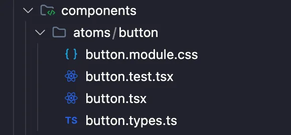

En este artículo comparto ideas para establecer una estructura sólida en proyectos React mediante un enfoque de componentes con módulos atómicos. Desde la organización inicial hasta las convenciones de nombres, veremos buenas prácticas para mantener una base de código organizada y preparada para crecer.

## Introducción

Mi objetivo es escribir un artículo cada semana hasta completar mi blog personal y dejar una recopilación de buenas prácticas.

Después de ver numerosos enfoques incorrectos, quiero compartir con la comunidad cómo prefiero hacer las cosas. React, al ser una biblioteca y no un framework, ofrece mucha libertad, pero también puede convertirse en una herramienta peligrosa con el tiempo, especialmente cuando los proyectos crecen. Quiero mostrar cómo abordar un proyecto desde el principio para evitar que ese crecimiento se vuelva un problema.

Algunos temas que trataré dependen en gran medida de la opinión personal, y otros desarrolladores pueden tener perspectivas distintas. Compartiré mi opinión y la comunidad podrá tomarla como una sugerencia, adoptando lo que mejor le funcione.

Este primer artículo trata sobre un proyecto base y cómo organizo su estructura inicial. Los tres enlaces y conceptos más importantes que conviene conocer antes de empezar son:

[Diseño atómico](https://bradfrost.com/blog/post/atomic-web-design/)

[Repositorio de GitHub](https://github.com/santi020k/posts/tree/post-1)

## La tecnología inicial incluye

- Next.js
- React
- Vitest
- Tailwind
- TypeScript
- ESLint

Es solo un proyecto base. En próximos artículos podremos agregar muchas más cosas, como un control previo al commit con Husky, Storybook, una mejor configuración de ESLint, etc.

## Estructura del proyecto base

<!-- TODO: Rewrite this historical article snippet as a valid standalone example before enabling ESLint for the fenced block. -->
<!-- eslint-skip -->
```text title="project-structure"
├── /config
| ├── /Tests
| | ├── /setup.ts

├── /public
| ├── /next.svg
| ├── /vercel.svg

├── /src
| ├── /app
| | ├── /favicon.ico
| | ├── /global.css
| | ├── /layout.tsx
| | ├── /page.tsx

| ├── /components
| | ├── /atoms
| | | ├── /button
| | | | ├── /button.module.css
| | | | ├── /button.test.tsx
| | | | ├── /button.tsx
| | | | ├── /button.type.ts

| | ├── /molecules
| | | ├── /button
| | | | ├── /group-buttons.test.tsx
| | | | ├── /group-buttons.tsx

| | ├── /organisms
| | | ├── /.keep
```

El diseño atómico me parece una estructura ideal porque es la misma que se utiliza en diseño. Esto facilita mucho la implementación. He visto numerosos proyectos en los que los componentes simplemente se acumulan en una carpeta y contienen otros componentes dentro. Así resulta muy difícil navegar y encontrar las cosas. A medida que la aplicación crece, se vuelve caótico. Recomiendo evitar esas prácticas y organizar mejor los componentes.

Este es un ejemplo de un componente de botón:



Otro error común en el desarrollo frontend es separar el código de un componente en varias carpetas: una para pruebas, otra para interfaces y tipos, otra para componentes, etc. Esto complica mucho la navegación por el código. Personalmente, prefiero mantener todo lo relacionado con un componente en un mismo lugar, como en el ejemplo anterior.

Un tema bastante controvertido es cómo nombrar carpetas y archivos. En mi experiencia, dejar libertad o no tener un patrón claro puede generar implementaciones mezcladas: un desarrollador hace algo de una manera y otro lo hace de otra. Con el tiempo se convierte en un dolor de cabeza cada vez más difícil de resolver a medida que crece el proyecto. Mi sugerencia es mantenerlo sencillo y fácil de entender.

Por ejemplo, considero una mala práctica usar `PascalCase` para los archivos de componentes. Estos son algunos errores comunes:

- `GroupButtons/GroupButtons.tsx`
- `group-buttons/GroupButtons.tsx`
- `GroupButtons/group-buttons.tsx`

Nota: he visto todos los estilos de nombres dentro de una misma carpeta, incluido `snake_case`.

Personalmente, prefiero usar `kebab-case` para todo lo relacionado con archivos. Así evito que mi equipo se confunda y use una mayúscula donde no corresponde. Cuanto más estandarizadas estén estas cosas, mejor se trabaja con equipos grandes: no necesitan pensar en cómo escribir el nombre, solo en elegir un buen nombre para el archivo.

Prefiero estandarizar estas decisiones para evitar que mi equipo se ponga demasiado creativo con la estructura del proyecto.

- `group-buttons/group-buttons.tsx`

Decidir si el componente debe llamarse `index.tsx` o `button.tsx` también es un tema complejo. He usado ambas opciones. Prefiero button.tsx porque, al buscar archivos con una herramienta como la de VS Code, resulta más fácil entender qué es un archivo sin leer toda su ruta. Otra práctica que me gusta es mantener siempre el componente en una carpeta con el mismo nombre, aunque esté solo. Es un poco repetitivo, pero evita archivos sueltos que después podrían crecer en el lugar equivocado.

Un consejo útil es importar y exportar todo desde el componente principal, para no necesitar tantas importaciones cuando se requiere algo relacionado con un proyecto.

<!-- TODO: Rewrite this historical article snippet as a valid standalone example before enabling ESLint for the fenced block. -->
<!-- eslint-skip -->
```javascript title="src/components/atoms/button/button.tsx"
import styles from './button.module.css';
import { type ButtonProps, types } from './button.types'

const Button: React.FC<ButtonProps> = ({ children, onClick, type }) => {
  const buttonClasses = `${styles.button} ${type === types.primary ? styles.primary : styles.secondary}`;

  return (
    <button className={buttonClasses} onClick={onClick}>
      {children}
    </button>
  );
};

export default Button;

export { ButtonProps, types }
```

Hay muchos temas relacionados con la calidad del código, como las cadenas de texto mágicas, el tipado y las pruebas, que no tengo tiempo de cubrir en este artículo. En el siguiente trataremos otros temas mientras avanzamos en el proyecto semana a semana. Dejaré las ramas con el contenido de cada artículo por si la rama principal cambia mucho con el tiempo y necesitan acceder a un estado específico del proyecto.

Espero que les resulte útil. Si tienen preguntas, no duden en contactarme. Con gusto responderé, siempre que esté dentro de mis capacidades.
