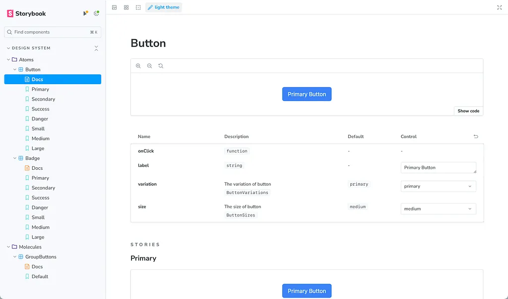

import PackageManagerCodeTabs from '@/components/molecules/PackageManagerCodeTabs.astro'

Después del artículo anterior sobre la optimización del flujo de desarrollo, hoy exploraremos la experiencia de desarrollo visual, o VDE, con Storybook junto a Next.js. Mientras la conversación anterior destacó los controles previos al commit para mantener la calidad y estabilidad del código, esta vez veremos cómo mejorar el desarrollo de interfaces mediante el entorno de componentes aislados de Storybook. Aprovechemos estas herramientas para simplificar el trabajo, mejorar la colaboración y mantener interfaces consistentes en distintos proyectos.

[Lee el artículo anterior: implementar Husky en Next.js](https://medium.com/@santi020k/development-workflow-with-husky-for-next-js-eslint-and-vitest-integration-d75548e48092)

[Repositorio de GitHub](https://github.com/santi020k/posts/pull/5)

## Primeros pasos con Storybook

Para integrar Storybook en tu proyecto Next.js, ejecuta el siguiente comando:

{/* TODO: Rewrite this historical article snippet as a valid standalone example before enabling ESLint for the fenced block. */}
{/* eslint-skip */}
```bash title="terminal"
npx sb init
```

Este comando inicia la instalación de dependencias, la configuración y la creación de archivos necesarios.

Una vez instalado, inicia Storybook para visualizar tus componentes e interactuar con ellos en un entorno aislado:

<PackageManagerCodeTabs
  ariaLabel="Elige un gestor de paquetes para iniciar Storybook"
  commands={{
    npm: 'npm run storybook',
    yarn: 'yarn run storybook',
    pnpm: 'pnpm run storybook',
    bun: 'bun run storybook'
  }}
/>

Recomiendo eliminar los componentes de demostración y configurar los componentes existentes. En nuestro caso, como usamos alias para las importaciones, pueden aparecer problemas de compatibilidad. Para resolverlos, agrega esta configuración a Storybook:

`.storybook/main.ts`

{/* TODO: Rewrite this historical article snippet as a valid standalone example before enabling ESLint for the fenced block. */}
{/* eslint-skip */}
```typescript title=".storybook/main.ts"
import type { StorybookConfig } from "@storybook/nextjs";
import path from 'path'

const config: StorybookConfig = {
  stories: ["../src/**/*.mdx", "../src/**/*.stories.@(js|jsx|mjs|ts|tsx)"],
  addons: [
    "@storybook/addon-onboarding",
    "@storybook/addon-links",
    "@storybook/addon-essentials",
    "@chromatic-com/storybook",
    "@storybook/addon-interactions",
  ],
  framework: {
    name: "@storybook/nextjs",
    options: {},
  },
  docs: {
    autodocs: "tag",
  },
  staticDirs: ["../public"],
  webpackFinal: async (config) => {
    if (!config.resolve) return config;

    config.resolve.alias = {
      ...config.resolve.alias,
      '@/': path.resolve(__dirname, '../src/'),
      '@/atoms': path.resolve(__dirname, '../src/components/atoms'),
      '@/molecules': path.resolve(__dirname, '../src/components/molecules'),
      '@/organisms': path.resolve(__dirname, '../src/components/organisms')
    };

    return config;
  }
};

export default config;
```

Nota: la nueva forma de implementar alias en TypeScript es mejor; en un próximo artículo podemos migrar nuestra configuración a ella.

Con esta configuración resolvemos el problema sin complicaciones.

## Integración con Tailwind

Habilitar Tailwind es sencillo. Agrega la siguiente línea a la vista previa de Storybook:

`.storybook/preview.ts`

{/* TODO: Rewrite this historical article snippet as a valid standalone example before enabling ESLint for the fenced block. */}
{/* eslint-skip */}
```typescript title=".storybook/preview.ts"
import "../src/app/globals.css";
```

Este es un ejemplo:

`.storybook/preview.ts`

{/* TODO: Rewrite this historical article snippet as a valid standalone example before enabling ESLint for the fenced block. */}
{/* eslint-skip */}
```typescript title=".storybook/preview.ts"
import type { Preview } from "@storybook/react";

import "../src/app/globals.css";

const preview: Preview = {
  parameters: {
    controls: {
      matchers: {
        color: /(background|color)$/i,
        date: /Date$/i,
      },
    },
  },
};
export default preview;
```

Ahora que tenemos Storybook instalado en el proyecto, hagamos algunos ajustes.

## Opcional, pero recomendado

En muchos proyectos, las configuraciones en la raíz pueden volverse abrumadoras. Por eso recomiendo gestionarlas dentro de una carpeta dedicada. Aunque es opcional, sugiero mover la carpeta **.storybook** a **config/.storybook**.

Para hacerlo, realiza los siguientes cambios:

Mueve **main** y **preview** de la raíz del proyecto a:

{/* TODO: Rewrite this historical article snippet as a valid standalone example before enabling ESLint for the fenced block. */}
{/* eslint-skip */}
```text title="Project Structure"
├── /config
| ├── /.storybook
| | ├── /main.ts
| | ├── /preview.ts
```

Ajusta los scripts de Storybook en package.json:

`package.json`

{/* TODO: Rewrite this historical article snippet as a valid standalone example before enabling ESLint for the fenced block. */}
{/* eslint-skip */}
```json title="package.json"
{
  "scripts": {
    "storybook": "storybook dev -p 6006 -c config/.storybook",
    "build-storybook": "storybook build -c config/.storybook"
  }
}
```

Y actualiza la configuración principal de Storybook:

`config/.storybook/main.ts`

{/* TODO: Rewrite this historical article snippet as a valid standalone example before enabling ESLint for the fenced block. */}
{/* eslint-skip */}
```typescript title="config/.storybook/main.ts"
import type { StorybookConfig } from "@storybook/nextjs";
import path from 'path'

const rootDir = path.resolve(__dirname, '../..');

const config: StorybookConfig = {
  stories: [`${rootDir}/**/*.mdx`, `${rootDir}/**/*.stories.@(js|jsx|mjs|ts|tsx)`],
  addons: [
    "@storybook/addon-onboarding",
    "@storybook/addon-links",
    "@storybook/addon-essentials",
    "@chromatic-com/storybook",
    "@storybook/addon-interactions",
  ],
  framework: {
    name: "@storybook/nextjs",
    options: {},
  },
  docs: {
    autodocs: "tag",
  },
  staticDirs: [`${rootDir}/public`],
  webpackFinal: async (config) => {
    if (!config.resolve) return config;

    config.resolve.alias = {
      ...config.resolve.alias,
      '@/': `${rootDir}/src/`,
      '@/atoms': `${rootDir}/src/components/atoms`,
      '@/molecules': `${rootDir}/src/components/molecules`,
      '@/organisms': `${rootDir}/src/components/organisms`
    };

    return config;
  }
};

export default config;
```

`config/.storybook/preview.ts`

{/* TODO: Rewrite this historical article snippet as a valid standalone example before enabling ESLint for the fenced block. */}
{/* eslint-skip */}
```typescript title="config/.storybook/preview.ts"
import type { Preview, ReactRenderer } from "@storybook/react";
import { withThemeByClassName } from '@storybook/addon-themes';
import '@storybook/addon-console';

import "../../src/app/globals.css";

// Preview configurations...

export default preview;
```

Ahora crear historias de componentes es sencillo. Usemos nuestro botón como ejemplo:

`src/components/atoms/button/button.stories.ts`

{/* TODO: Rewrite this historical article snippet as a valid standalone example before enabling ESLint for the fenced block. */}
{/* eslint-skip */}
```typescript title="src/components/atoms/button/button.stories.ts"
import Button, { type ButtonProps, ButtonSizes, ButtonVariations } from './button'

import type { Meta, StoryObj } from '@storybook/react'
import { fn } from '@storybook/test'

const meta = {
  title: 'Design System/Atoms/Button',
  component: Button,
  parameters: {
    layout: 'centered'
  },
  tags: ['autodocs'],
  args: { onClick: fn() },
  argTypes: {
    variation: {
      control: { type: 'select' },
      description: 'The variation of button',
      options: Object.values(ButtonVariations),
      table: {
        defaultValue: { summary: ButtonVariations.Primary },
        type: { summary: 'ButtonVariations' }
      }
    },    size: {
      control: { type: 'select' },
      description: 'The size of button',
      options: Object.values(ButtonSizes),
      table: {
        defaultValue: { summary: ButtonSizes.Medium },
        type: { summary: 'ButtonSizes' }
      }
    }
  }
} satisfies Meta<typeof Button>

export default meta

type Story = StoryObj<ButtonProps>

export const Primary: Story = {
  args: {
    label: 'Primary Button',
    variation: ButtonVariations.Primary,
    size: ButtonSizes.Medium
  }
}

export const Secondary: Story = {
  args: {
    label: 'Secondary Button',
    variation: ButtonVariations.Secondary
  }
}

export const Success: Story = {
  args: {
    label: 'Success Button',
    variation: ButtonVariations.Success
  }
}

export const Danger: Story = {
  args: {
    label: 'Danger Button',
    variation: ButtonVariations.Danger
  }
}

export const Small: Story = {
  args: {
    label: 'Primary Button',
    variation: ButtonVariations.Primary,
    size: ButtonSizes.Small
  }
}

export const Medium: Story = {
  args: {
    label: 'Primary Button',
    variation: ButtonVariations.Primary,
    size: ButtonSizes.Medium
  }
}

export const Large: Story = {
  args: {
    label: 'Primary Button',
    variation: ButtonVariations.Primary,
    size: ButtonSizes.Large
  }
}
```

En el repositorio encontrarás dos ejemplos adicionales, tanto de Vitest como de historias.

El resultado final se verá así:



## Mejora Storybook con integraciones

- **Themes**: [https://storybook.js.org/addons/@storybook/addon-themes](https://storybook.js.org/addons/@storybook/addon-themes) Prepara mejoras futuras implementando temas claro y oscuro.
- **Storysource:** [https://storybook.js.org/addons/@storybook/addon-storysource](https://storybook.js.org/addons/@storybook/addon-storysource) Consulta el código fuente de tus historias para mejorar el flujo de desarrollo.
- **Console:** [https://storybook.js.org/addons/@storybook/addon-console](https://storybook.js.org/addons/@storybook/addon-console) Depura tus componentes de forma eficaz con registros de consola integrados.
- **HTML Preview:** [https://storybook.js.org/addons/@whitespace/storybook-addon-html](https://storybook.js.org/addons/@whitespace/storybook-addon-html) Visualiza e inspecciona fragmentos HTML directamente en Storybook para crear prototipos con rapidez.
- **Pseudo States:** [https://storybook.js.org/addons/storybook-addon-pseudo-states](https://storybook.js.org/addons/storybook-addon-pseudo-states) Simula estados como hover, focus y active para probar los componentes a fondo.

Para instalar estas integraciones, elige tu gestor de paquetes:

<PackageManagerCodeTabs
  ariaLabel="Elige un gestor de paquetes para instalar las integraciones de Storybook"
  commands={{
    npm: 'npm install --save-dev @storybook/addon-themes @storybook/addon-storysource @storybook/addon-console @storybook/addon-actions @whitespace/storybook-addon-html storybook-addon-pseudo-states',
    yarn: 'yarn add --dev @storybook/addon-themes @storybook/addon-storysource @storybook/addon-console @storybook/addon-actions @whitespace/storybook-addon-html storybook-addon-pseudo-states',
    pnpm: 'pnpm add --save-dev @storybook/addon-themes @storybook/addon-storysource @storybook/addon-console @storybook/addon-actions @whitespace/storybook-addon-html storybook-addon-pseudo-states',
    bun: 'bun add --dev @storybook/addon-themes @storybook/addon-storysource @storybook/addon-console @storybook/addon-actions @whitespace/storybook-addon-html storybook-addon-pseudo-states'
  }}
/>

### Nota

Aunque estas integraciones son recomendadas, puedes explorar e instalar otras según los requisitos de tu proyecto. Encontrarás más en la página de [integraciones de Storybook](https://storybook.js.org/integrations/).

Una vez instaladas, actualiza los archivos de configuración de la siguiente manera:

`config/.storybook/main.ts`

{/* TODO: Rewrite this historical article snippet as a valid standalone example before enabling ESLint for the fenced block. */}
{/* eslint-skip */}
```typescript title="config/.storybook/main.ts"
import type { StorybookConfig } from "@storybook/nextjs";
import path from 'path'

import '@storybook/addon-console';

const rootDir = path.resolve(__dirname, '../..');

const config: StorybookConfig = {
  stories: [`${rootDir}/**/*.mdx`, `${rootDir}/**/*.stories.@(js|jsx|mjs|ts|tsx)`],
  addons: [
    "@storybook/addon-onboarding",
    "@storybook/addon-links",
    "@storybook/addon-essentials",
    "@chromatic-com/storybook",
    "@storybook/addon-interactions",
    "@storybook/addon-themes",
    "@storybook/addon-storysource",
    "@whitespace/storybook-addon-html",
    "storybook-addon-pseudo-states"
  ],
  framework: {
    name: "@storybook/nextjs",
    options: {},
  },
  docs: {
    autodocs: "tag",
  },
  staticDirs: [`${rootDir}/public`],
  webpackFinal: async (config) => {
    if (!config.resolve) return config;
    config.resolve.alias = {
      ...config.resolve.alias,
      '@/': `${rootDir}/src/`,
      '@/atoms': `${rootDir}/src/components/atoms`,
      '@/molecules': `${rootDir}/src/components/molecules`,
      '@/organisms': `${rootDir}/src/components/organisms`
    };
    return config;
  }
};
export default config;
```

`config/.storybook/preview.ts`

{/* TODO: Rewrite this historical article snippet as a valid standalone example before enabling ESLint for the fenced block. */}
{/* eslint-skip */}
```typescript title="config/.storybook/preview.ts"
import type { Preview, ReactRenderer } from "@storybook/react";
import { withThemeByClassName } from '@storybook/addon-themes';
import '@storybook/addon-console';

import "../../src/app/globals.css";

const preview: Preview = {
  parameters: {
    controls: {
      matchers: {
        color: /(background|color)$/i,
        date: /Date$/i,
      },
    },
  },
  decorators: [
    withThemeByClassName<ReactRenderer>({
      themes: {
        light: 'light',
        dark: 'dark',
      },
      defaultTheme: 'light',
    }),
  ]
};

export default preview;
```

## Conclusiones

Integrar Storybook con estos complementos puede mejorar tu flujo de desarrollo, simplificar las pruebas de componentes y fortalecer la colaboración del equipo. Experimenta con distintas integraciones para adaptar Storybook a las necesidades particulares del proyecto y crear un entorno de trabajo más eficiente y productivo.

Antes de integrar Storybook, considera su mantenimiento continuo. Es fundamental para mantener actualizada la documentación y evitar problemas. El cuidado periódico incluye actualizar componentes, realizar pruebas y comprobar la compatibilidad de dependencias. Evalúa los beneficios frente al esfuerzo de mantenimiento según la etapa y los recursos del proyecto.
