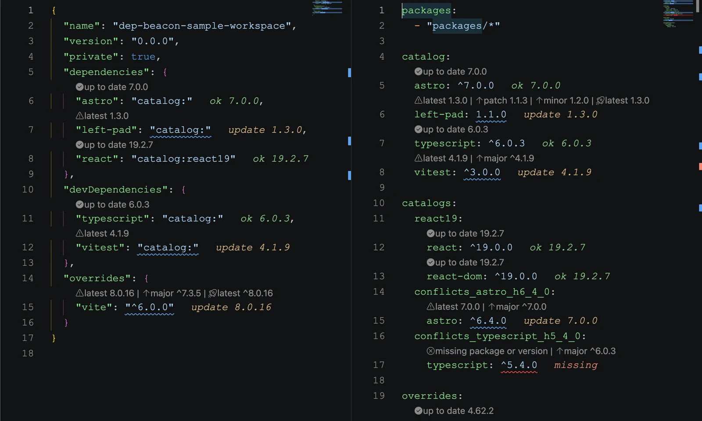

import ProjectArchitectureBrief from '@/components/molecules/ProjectArchitectureBrief.astro'
import ProjectCapabilityEntry from '@/components/molecules/ProjectCapabilityEntry.astro'
import ProjectCapabilitySpread from '@/components/molecules/ProjectCapabilitySpread.astro'
import ProjectContextLead from '@/components/molecules/ProjectContextLead.astro'
import ProjectIntentBrief from '@/components/molecules/ProjectIntentBrief.astro'
import ProjectOutcomesCard from '@/components/molecules/ProjectOutcomesCard.astro'
import ProjectPrincipleClose from '@/components/molecules/ProjectPrincipleClose.astro'
import ProjectSectionHeading from '@/components/molecules/ProjectSectionHeading.astro'

<ProjectContextLead projectId="dep-beacon" headingId="building-dependency-signals-for-vs-code-and-zed">

## Crear señales de dependencias para VS Code y Zed

Dep Beacon es un motor de análisis de dependencias para proyectos npm con extensiones para VS Code y Zed. Lleva el estado de las versiones, objetivos seguros de actualización, reconocimiento de catálogos de pnpm y alertas de vulnerabilidades de OSV directamente a los manifiestos que los desarrolladores ya editan.

El proyecto incluye un núcleo de análisis compartido, una extensión de VS Code, un servidor de lenguaje con un adaptador para Zed y un sitio de documentación en Astro en [beacon.santi020k.com](https://beacon.santi020k.com/). La extensión de VS Code está disponible en [Visual Studio Marketplace](https://marketplace.visualstudio.com/items?itemName=santi020k.vscode-dep-beacon) y [Open VSX](https://open-vsx.org/extension/santi020k/vscode-dep-beacon).

La [extensión de Dep Beacon para Zed](https://zed.dev/extensions/dep-beacon-lsp) ya está disponible en el registro de extensiones de Zed. Incorpora diagnósticos de dependencias, información al pasar el cursor, enlaces a npm y acciones de actualización individuales o masivas mediante Language Server Protocol. Consulta la [guía de instalación en Zed](https://beacon.santi020k.com/docs/zed-extension) para configurarla y usarla.

</ProjectContextLead>

<ProjectOutcomesCard
  contextLinks={[
    { label: "Funciones", href: "#what-i-built" },
    { label: "Aspectos técnicos", href: "#technical-highlights" },
    { label: "Resultados", href: "#results" }
  ]}
  headingId="outcomes"
  id="sidebar-outcomes"
  projectId="dep-beacon"
>

### Logros

</ProjectOutcomesCard>

<ProjectSectionHeading>

### Objetivos

</ProjectSectionHeading>

<ProjectIntentBrief labelledBy="goals">

<li>

**Mantener las decisiones de dependencias en contexto** mostrando su estado junto a los rangos de versiones que los desarrolladores ya revisan.

</li>

<li>

**Hacer prácticos los objetivos de actualización** con acciones de parche, versión menor, versión mayor y última versión que conservan prefijos habituales como `^` y `~`.

</li>

<li>

**Respetar la política del espacio de trabajo** resolviendo los catálogos predeterminados y con nombre de pnpm antes de informar el estado de los paquetes.

</li>

<li>

**Mostrar pronto el riesgo de seguridad** con consultas a avisos de OSV que distinguen el mantenimiento habitual de rangos de dependencias vulnerables.

</li>

</ProjectIntentBrief>

<ProjectSectionHeading>

### Qué construí

</ProjectSectionHeading>

<ProjectCapabilitySpread labelledBy="what-i-built">

<ProjectCapabilityEntry number={1} title={"Un núcleo de análisis compartido"}>

(`@santi020k/dep-beacon-core`) que interpreta manifiestos de paquetes, metadatos del registro npm, rangos semver, catálogos de pnpm y respuestas de avisos de OSV.

</ProjectCapabilityEntry>

<ProjectCapabilityEntry number={2} title={"Una extensión de VS Code"}>

(`vscode-dep-beacon`) con acciones de actualización CodeLens, indicadores de estado junto al código, diagnósticos, ordenación, controles de caché, opciones de versiones preliminares y comandos de instalación.

</ProjectCapabilityEntry>

<ProjectCapabilityEntry number={3} title={"Una integración con Zed"}>

basada en `@santi020k/dep-beacon-lsp` y un adaptador pequeño de Rust/WebAssembly, con diagnósticos de dependencias, información al pasar el cursor y acciones de código para actualizar.

</ProjectCapabilityEntry>

<ProjectCapabilityEntry number={4} title={"Compatibilidad con manifiestos"}>

para `package.json`, sobrescrituras de npm, resoluciones de Yarn, sobrescrituras de pnpm, `pnpm-workspace.yaml`, catálogos predeterminados, catálogos con nombre y extensiones de paquetes.

</ProjectCapabilityEntry>

<ProjectCapabilityEntry number={5} title={"Un sitio de documentación"}>

construido con Astro, que cubre instalación, configuración, uso en VS Code, comportamiento de espacios de trabajo de pnpm y señales de seguridad.

</ProjectCapabilityEntry>

<ProjectCapabilityEntry number={6} title={"Herramientas de publicación"}>

para validar paquetes, empaquetar extensiones, publicar en el marketplace y Open VSX, y desplegar la documentación.

</ProjectCapabilityEntry>

</ProjectCapabilitySpread>

<ProjectSectionHeading>

### Aspectos técnicos

</ProjectSectionHeading>

<ProjectArchitectureBrief>

  <dt>Integración con Zed</dt>
  <dd>

Un servidor de lenguaje comparte el análisis de dependencias con la extensión de VS Code y expone diagnósticos, información al pasar el cursor y acciones de código en Zed.

  </dd>

  <dt>Integración con VS Code</dt>
  <dd>

`VS Code Extension API`, proveedores CodeLens, diagnósticos, aportes de comandos, canales de salida y activación según el documento.

  </dd>

  <dt>Análisis de dependencias</dt>
  <dd>

Consultas a registros compatibles con npm, selección de objetivos semver, interpretación de rangos, controles de versiones preliminares y análisis que aprovecha la caché.

  </dd>

  <dt>Conocimiento del espacio de trabajo</dt>
  <dd>

Instantáneas de catálogos de pnpm, sobrescrituras, extensiones de paquetes y secciones del manifiesto que centralizan la política de dependencias.

  </dd>

  <dt>Verificaciones de seguridad</dt>
  <dd>

Consultas de vulnerabilidades en OSV.dev que convierten la gravedad de los avisos en estados visibles en el editor.

  </dd>

  <dt>Documentación</dt>
  <dd>

Una aplicación de documentación en Astro con recursos de vista previa generados, imágenes Open Graph y páginas de configuración específicas.

  </dd>

</ProjectArchitectureBrief>

<ProjectSectionHeading>

### Resultados

</ProjectSectionHeading>

- **Disponible tanto en VS Code como en Zed**, con integraciones específicas de cada editor construidas sobre el mismo núcleo de análisis de dependencias.
- **Mantenimiento de dependencias dentro del editor**, en lugar de otro panel o un flujo exclusivo de terminal.
- **Decisiones de actualización más seguras**, con opciones claras de parche, versión menor, mayor y última versión.
- **Mejor compatibilidad con monorepos** para equipos que utilizan catálogos de pnpm para coordinar versiones entre paquetes.
- **Una vía de seguridad que respeta la privacidad**, donde se pueden desactivar las consultas de OSV si el equipo no quiere enviar datos de paquetes y versiones a un servicio externo de avisos.

<ProjectSectionHeading>

### Por qué importa

</ProjectSectionHeading>

<ProjectPrincipleClose lead={"Las revisiones de dependencias suelen ser decisiones pequeñas y repetitivas, hasta que dejan de serlo."}>

Un rango está desactualizado. Otro se gestiona con un catálogo. Otro es vulnerable. Otro no es válido o no está publicado. Dep Beacon convierte esas verificaciones dispersas en señales visibles en el editor para decidir más rápido sin perder los matices de cada línea del manifiesto.

</ProjectPrincipleClose>

Ese es el tipo de herramienta para desarrolladores que me gusta construir: lo bastante pequeña para mantenerse cerca del flujo de trabajo, pero con criterios suficientemente claros para quitar fricción cada vez que se abre el archivo.
