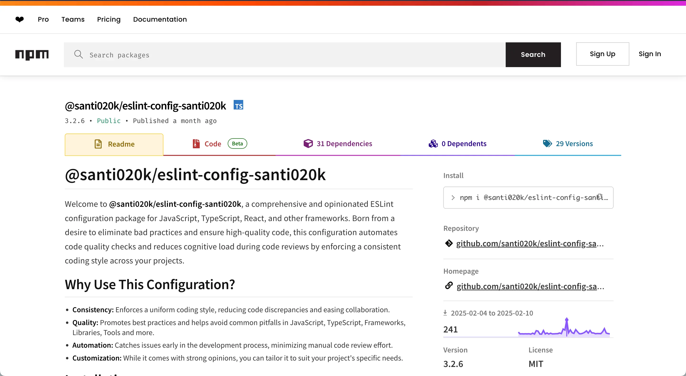

import ProjectCapabilityEntry from '@/components/molecules/ProjectCapabilityEntry.astro'
import ProjectCapabilitySpread from '@/components/molecules/ProjectCapabilitySpread.astro'
import ProjectContextLead from '@/components/molecules/ProjectContextLead.astro'
import ProjectIntentBrief from '@/components/molecules/ProjectIntentBrief.astro'
import ProjectOutcomesCard from '@/components/molecules/ProjectOutcomesCard.astro'
import ProjectPrincipleClose from '@/components/molecules/ProjectPrincipleClose.astro'
import ProjectSectionHeading from '@/components/molecules/ProjectSectionHeading.astro'

<ProjectContextLead projectId="eslint-config-basic" headingId="building-a-dx-first-eslint-toolkit">

## Crear herramientas de ESLint centradas en la experiencia de desarrollo

Creé `@santi020k/eslint-config-basic` para eliminar la fricción de configurar lint en los proyectos en los que más trabajo: React, Next.js, Astro, TypeScript y monorepos con equipos reales detrás. Es el sucesor de mi paquete original [`@santi020k/eslint-config-santi020k`](/es/portfolio/eslint-config-santi020k/), reconstruido desde cero alrededor del formato de configuración plana de ESLint, con muchos más frameworks compatibles y una mejor experiencia de desarrollo en todo el proceso.

</ProjectContextLead>

<ProjectOutcomesCard
  contextLinks={[
    { label: "Funciones", href: "#what-i-built" },
    { label: "Resultados", href: "#results" }
  ]}
  headingId="outcomes"
  id="sidebar-outcomes"
  projectId="eslint-config-basic"
>

### Logros

</ProjectOutcomesCard>

<ProjectSectionHeading>

### Objetivos

</ProjectSectionHeading>

<ProjectIntentBrief labelledBy="goals">

<li>

**Reducir la fricción de configuración** en nuevos proyectos para que los equipos lleguen más rápido a estándares útiles.

</li>

<li>

**Definir valores predeterminados sólidos** basados en trabajo real con aplicaciones frontend, herramientas, sitios Astro y monorepos.

</li>

<li>

**Mantener la composición modular** para que cada conjunto tecnológico elija lo que necesita en lugar de heredar un monolito enorme.

</li>

</ProjectIntentBrief>

<ProjectSectionHeading>

### Qué construí

</ProjectSectionHeading>

<ProjectCapabilitySpread labelledBy="what-i-built">

<ProjectCapabilityEntry number={1} title={"Un núcleo componible de ESLint"}>

para proyectos de JavaScript y TypeScript, con detección automática de los frameworks y herramientas que ya existen en el repositorio.

</ProjectCapabilityEntry>

<ProjectCapabilityEntry number={2} title={"Paquetes opcionales"}>

para `React`, `Next.js`, `Astro`, `Vue`, `Svelte`, `Solid`, `Angular`, `NestJS`, `Expo`, `Qwik` y `Remix`.

</ProjectCapabilityEntry>

<ProjectCapabilityEntry number={3} title={"Un modo estricto"}>

que convierte advertencias en errores para procesos CI/CD y flujos de equipo más exigentes.

</ProjectCapabilityEntry>

<ProjectCapabilityEntry number={4} title={"Compatibilidad de primer nivel con Tailwind CSS, Vitest y Testing Library,"}>

además de documentación y ejemplos que facilitan la adopción para los equipos, no solo para mí.

</ProjectCapabilityEntry>

</ProjectCapabilitySpread>

<ProjectSectionHeading>

### Resultados

</ProjectSectionHeading>

- **Más de 229 descargas semanales de npm** en proyectos personales, de clientes y compartidos.
- **Menos trabajo de configuración repetido** al comenzar un nuevo proyecto o experimento.
- **Una expresión reutilizable de mis estándares de ingeniería** que otros equipos pueden adoptar y ampliar de verdad.

<ProjectSectionHeading>

### Por qué importa

</ProjectSectionHeading>

<ProjectPrincipleClose lead={"El lint rara vez es protagonista, pero cambia la manera de trabajar de los equipos."}>

Este proyecto refleja cómo pienso sobre las herramientas de desarrollo en general: eliminar fricción, definir buenos valores predeterminados y facilitar el mantenimiento de la calidad a escala.

</ProjectPrincipleClose>

