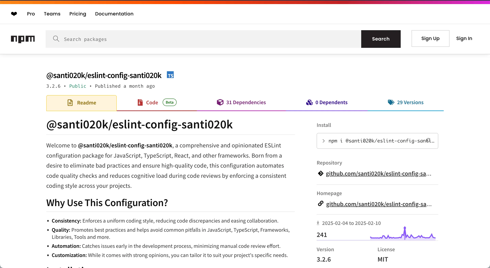

import ProjectCapabilityEntry from '@/components/molecules/ProjectCapabilityEntry.astro'
import ProjectCapabilitySpread from '@/components/molecules/ProjectCapabilitySpread.astro'
import ProjectContextLead from '@/components/molecules/ProjectContextLead.astro'
import ProjectIntentBrief from '@/components/molecules/ProjectIntentBrief.astro'
import ProjectOutcomesCard from '@/components/molecules/ProjectOutcomesCard.astro'
import ProjectPrincipleClose from '@/components/molecules/ProjectPrincipleClose.astro'
import ProjectReplacementNotice from '@/components/molecules/ProjectReplacementNotice.astro'
import ProjectSectionHeading from '@/components/molecules/ProjectSectionHeading.astro'

<ProjectReplacementNotice
  currentPackage="@santi020k/eslint-config-santi020k"
  href="/es/portfolio/eslint-config-basic/"
  replacementPackage="@santi020k/eslint-config-basic"
>
Su reemplazo permite mayor composición, tiene mejor documentación y se mantiene activamente.
</ProjectReplacementNotice>

<ProjectContextLead projectId="eslint-config-santi020k" headingId="building-my-original-eslint-toolkit">

## Crear mi primer conjunto de herramientas ESLint

`@santi020k/eslint-config-santi020k` fue mi primer paquete publicado de ESLint: un conjunto de reglas con criterios definidos para proyectos de JavaScript y TypeScript, diseñado para mantener la consistencia, detectar errores frecuentes pronto y reducir la configuración de las aplicaciones que construía con mayor frecuencia.

</ProjectContextLead>

<ProjectOutcomesCard
  contextLinks={[
    { label: "Herramientas", href: "#what-it-included" },
    { label: "Por qué se reemplazó", href: "#why-it-was-replaced" }
  ]}
  headingId="outcomes"
  id="sidebar-outcomes"
  projectId="eslint-config-santi020k"
>

### Logros

</ProjectOutcomesCard>

<ProjectSectionHeading>

### Objetivos

</ProjectSectionHeading>

<ProjectIntentBrief labelledBy="goals">

<li>

**Estandarizar la calidad del código** en mis propios proyectos y en los equipos con los que trabajaba.

</li>

<li>

**Reducir la fricción de configuración** al iniciar aplicaciones de React, Next.js y TypeScript.

</li>

<li>

**Hacer portables los buenos valores predeterminados** para que el lint formara parte del flujo y no fuera una tarea añadida al final.

</li>

</ProjectIntentBrief>

<ProjectSectionHeading>

### Qué incluía

</ProjectSectionHeading>

<ProjectCapabilitySpread labelledBy="what-it-included">

<ProjectCapabilityEntry number={1} title={"Valores estrictos para TypeScript y JavaScript"}>

orientados a evitar errores habituales y revisiones repetitivas.

</ProjectCapabilityEntry>

<ProjectCapabilityEntry number={2} title={"Compatibilidad integrada con React y Next.js"}>

con configuraciones opcionales para `Expo`, `Astro`, `TailwindCSS`, `Vitest` e `i18next`.

</ProjectCapabilityEntry>

<ProjectCapabilityEntry number={3} title={"Complementos modulares"}>

para que los proyectos incorporaran necesidades específicas de cada framework sin copiar configuraciones a mano.

</ProjectCapabilityEntry>

<ProjectCapabilityEntry number={4} title={"Publicación automatizada y ejemplos"}>

que hacían práctico mantener el paquete y facilitaban su adopción.

</ProjectCapabilityEntry>

</ProjectCapabilitySpread>

<ProjectSectionHeading>

### Por qué se reemplazó

</ProjectSectionHeading>

A medida que mis proyectos crecieron y el formato de configuración plana de ESLint se volvió el estándar, la arquitectura del paquete original se hizo más difícil de ampliar y mantener. En vez de seguir aplicando parches, reconstruí la idea desde cero como [`@santi020k/eslint-config-basic`](/es/portfolio/eslint-config-basic/), un conjunto más componible, compatible con más frameworks y mejor documentado.

<ProjectSectionHeading>

### Por qué fue importante

</ProjectSectionHeading>

<ProjectPrincipleClose lead={"Este proyecto fue la primera vez que convertí preferencias internas de ingeniería en una herramienta pública reutilizable."}>

Me ayudó a aclarar cómo pienso sobre las herramientas de desarrollo en general: eliminar configuración repetitiva, codificar lo que importa y facilitar la conservación de la calidad.

</ProjectPrincipleClose>

