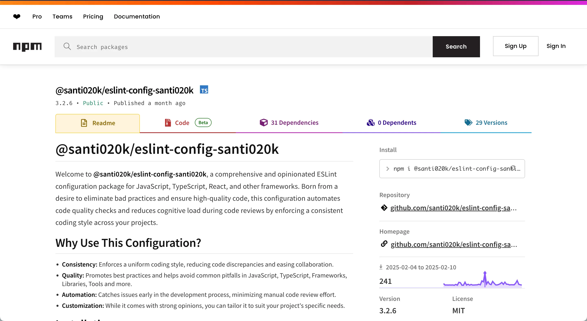

import ProjectCapabilityEntry from '@/components/molecules/ProjectCapabilityEntry.astro'
import ProjectCapabilitySpread from '@/components/molecules/ProjectCapabilitySpread.astro'
import ProjectContextLead from '@/components/molecules/ProjectContextLead.astro'
import ProjectIntentBrief from '@/components/molecules/ProjectIntentBrief.astro'
import ProjectOutcomesCard from '@/components/molecules/ProjectOutcomesCard.astro'
import ProjectPrincipleClose from '@/components/molecules/ProjectPrincipleClose.astro'
import ProjectReplacementNotice from '@/components/molecules/ProjectReplacementNotice.astro'
import ProjectSectionHeading from '@/components/molecules/ProjectSectionHeading.astro'

<ProjectReplacementNotice
  currentPackage="@santi020k/eslint-config-santi020k"
  href="/portfolio/eslint-config-basic/"
  replacementPackage="@santi020k/eslint-config-basic"
>
The replacement is more composable, better documented, and actively maintained.
</ProjectReplacementNotice>

<ProjectContextLead projectId="eslint-config-santi020k" headingId="building-my-original-eslint-toolkit">

## Building my original ESLint toolkit

`@santi020k/eslint-config-santi020k` was my first published ESLint package, an opinionated set of rules for JavaScript and TypeScript projects designed to enforce consistency, catch common mistakes early, and reduce setup work across the kinds of apps I was building most often.

</ProjectContextLead>

<ProjectOutcomesCard
  contextLinks={[
    { label: "Toolkit", href: "#what-it-included" },
    { label: "Why it was replaced", href: "#why-it-was-replaced" }
  ]}
  headingId="outcomes"
  id="sidebar-outcomes"
  projectId="eslint-config-santi020k"
>

### Outcomes

</ProjectOutcomesCard>

<ProjectSectionHeading>

### Goals

</ProjectSectionHeading>

<ProjectIntentBrief labelledBy="goals">

<li>

**Standardize code quality** across my own projects and the teams I worked with.

</li>

<li>

**Reduce setup friction** when spinning up React, Next.js, and TypeScript applications.

</li>

<li>

**Make good defaults portable** so linting could be part of the workflow instead of an afterthought.

</li>

</ProjectIntentBrief>

<ProjectSectionHeading>

### What it included

</ProjectSectionHeading>

<ProjectCapabilitySpread labelledBy="what-it-included">

<ProjectCapabilityEntry number={1} title={"Strict TypeScript and JavaScript defaults"}>

aimed at preventing common errors and review churn.

</ProjectCapabilityEntry>

<ProjectCapabilityEntry number={2} title={"Built-in support for React and Next.js"}>

with optional presets for `Expo`, `Astro`, `TailwindCSS`, `Vitest`, and `i18next`.

</ProjectCapabilityEntry>

<ProjectCapabilityEntry number={3} title={"Modular add-ons"}>

so projects could opt into framework-specific needs without copying configuration by hand.

</ProjectCapabilityEntry>

<ProjectCapabilityEntry number={4} title={"Automated publishing and examples"}>

that made the package practical to maintain and easier to adopt.

</ProjectCapabilityEntry>

</ProjectCapabilitySpread>

<ProjectSectionHeading>

### Why it was replaced

</ProjectSectionHeading>

As my projects grew and ESLint's flat config format became the standard, the original package architecture became harder to extend and maintain. Rather than continuing to patch it, I rebuilt the idea from scratch as [`@santi020k/eslint-config-basic`](/portfolio/eslint-config-basic/), a more composable toolkit with a wider framework footprint and better documentation.

<ProjectSectionHeading>

### Why it mattered

</ProjectSectionHeading>

<ProjectPrincipleClose lead={"This project was the first time I turned internal engineering preferences into a reusable public tool."}>

It helped clarify how I think about developer tooling in general: remove repetitive setup, codify what matters, and make quality easier to keep.

</ProjectPrincipleClose>

