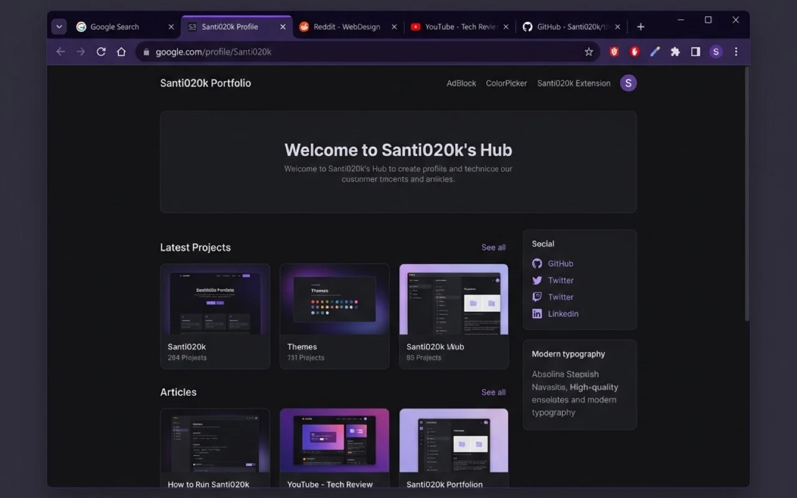
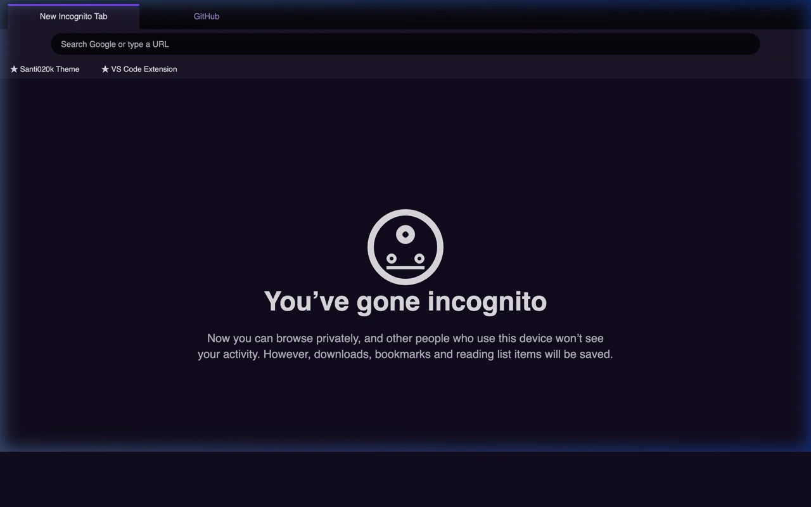
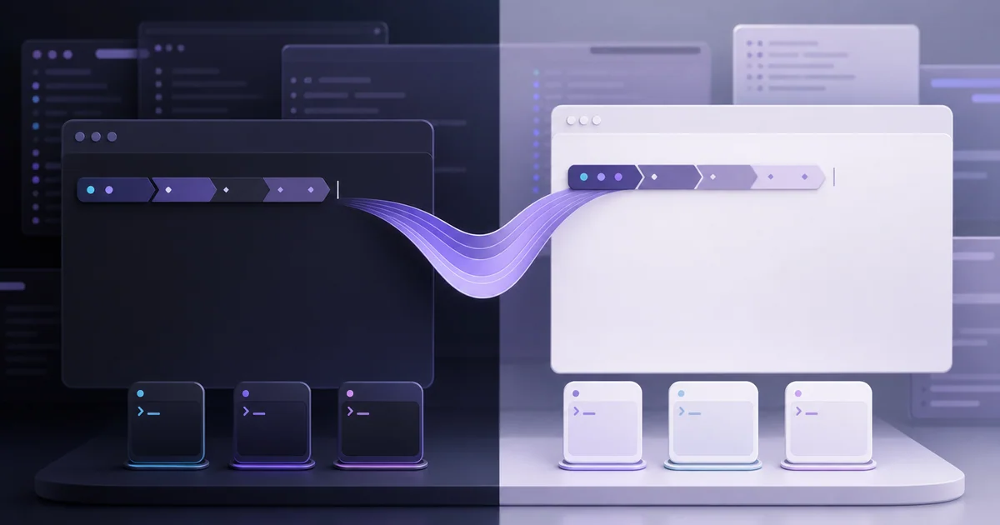
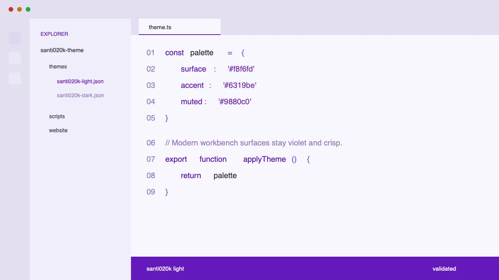

import ProjectCapabilityEntry from '@/components/molecules/ProjectCapabilityEntry.astro'
import ProjectCapabilitySpread from '@/components/molecules/ProjectCapabilitySpread.astro'
import ProjectContextLead from '@/components/molecules/ProjectContextLead.astro'
import ProjectIntentBrief from '@/components/molecules/ProjectIntentBrief.astro'
import ProjectOutcomesCard from '@/components/molecules/ProjectOutcomesCard.astro'
import ProjectPrincipleClose from '@/components/molecules/ProjectPrincipleClose.astro'
import ProjectSectionHeading from '@/components/molecules/ProjectSectionHeading.astro'

<ProjectContextLead projectId="santi020k-theme" headingId="building-one-theme-family-across-the-developer-workspace">

## Crear una familia de temas para todo el espacio de desarrollo

Comencé Santi020k Theme como un par de temas de editor para las herramientas que uso a diario. Ha crecido hasta reunir nueve productos: VS Code, Zed, Codex, Chrome, terminales, Raycast, Slack, IDE de JetBrains y Xcode. Los paquetes compartidos también admiten resaltado de sintaxis con Shiki, sitios web, prompts y shells. El monorepo reúne estos productos con guías de instalación y vistas previas en [theme.santi020k.com](https://theme.santi020k.com/).

La familia comparte un lenguaje de color violeta tranquilo y respeta las capacidades de cada entorno. VS Code y editores compatibles reciben resaltado semántico y variantes de alto contraste. Chrome recibe asignaciones declarativas claras y oscuras sin permisos. Los consumidores de Shiki reciben temas de sintaxis importables. Las terminales reciben formatos de paleta generados y prompts capaces de seguir la apariencia del sistema.

</ProjectContextLead>

<ProjectOutcomesCard
  contextLinks={[
    { label: "Funciones", href: "#what-i-built" },
    { label: "Resultados", href: "#results" }
  ]}
  headingId="outcomes"
  id="sidebar-outcomes"
  projectId="santi020k-theme"
>

### Logros

</ProjectOutcomesCard>

<ProjectSectionHeading>

### Objetivos

</ProjectSectionHeading>

<ProjectIntentBrief labelledBy="goals">

<li>

**Crear un espacio de trabajo tranquilo** con perfiles oscuros, claros y de alto contraste coordinados para sesiones técnicas largas.

</li>

<li>

**Basar cada entorno en tokens** para que editores, interfaz del navegador, vistas de código, terminales, prompts y sitios evolucionen desde la misma fuente.

</li>

<li>

**Respetar las preferencias tipográficas** con variantes base, negrita y cursiva de VS Code, en lugar de un único tratamiento de sintaxis.

</li>

<li>

**Publicar cada entorno como un producto** con documentación, vistas previas, validación, empaquetado y automatización de versiones específicos.

</li>

</ProjectIntentBrief>

<ProjectSectionHeading>

### Qué construí

</ProjectSectionHeading>

<ProjectCapabilitySpread labelledBy="what-i-built">

<ProjectCapabilityEntry number={1} title={"Doce variantes de VS Code"}>

distribuidas entre perfiles oscuro, claro, oscuro de alto contraste y claro de alto contraste, cada uno con opciones de sintaxis base, negrita y cursiva.

</ProjectCapabilityEntry>

<ProjectCapabilityEntry number={2} title={"Una extensión de tema publicada para Zed"}>

con variantes oscuras y claras generadas desde la paleta compartida, disponible en el [registro de extensiones de Zed](https://zed.dev/extensions/santi020k-theme).

</ProjectCapabilityEntry>

<ProjectCapabilityEntry number={3} title={"Temas personalizados predefinidos para Codex"}>

disponibles en la [página de temas de Codex](https://theme.santi020k.com/codex/), con ajustes de apariencia listos para copiar.

</ProjectCapabilityEntry>

<ProjectCapabilityEntry number={4} title={"Temas de Raycast Pro y Slack"}>

con URL de importación de Raycast y cadenas de colores personalizados y mapas semánticos para Slack.

</ProjectCapabilityEntry>

<ProjectCapabilityEntry number={5} title={"Compatibilidad con JetBrains y Android Studio"}>

mediante un complemento instalable claro y oscuro que cubre tanto la interfaz del IDE como la sintaxis del editor.

</ProjectCapabilityEntry>

<ProjectCapabilityEntry number={6} title={"Temas nativos de Xcode"}>

para sintaxis del editor y colores de la consola de depuración en modos claro y oscuro.

</ProjectCapabilityEntry>

<ProjectCapabilityEntry number={7} title={"Temas claros y oscuros de Chrome"}>

que asignan las áreas del navegador a tokens nombrados del editor y se distribuyen sin permisos, recopilación de datos ni código remoto.

</ProjectCapabilityEntry>

<ProjectCapabilityEntry number={8} title={"Un producto para terminales"}>

con paletas claras y oscuras para iTerm2, Ghostty, Kitty, WezTerm, Windows Terminal y Alacritty.

</ProjectCapabilityEntry>

<ProjectCapabilityEntry number={9} title={"Configuraciones de Starship completas, portables y mínimas"}>

junto con integración gestionada de Zsh, Bash y Fish con selección automática de apariencia.

</ProjectCapabilityEntry>

<ProjectCapabilityEntry number={10} title={"Paquetes compartidos @santi020k/theme y @santi020k/theme-core"}>

para tokens, recursos, metadatos, asignaciones de Chrome, valores Tailwind, comportamiento del sitio y temas importables de Shiki.

</ProjectCapabilityEntry>

<ProjectCapabilityEntry number={11} title={"Un sitio Astro consolidado"}>

para los nueve productos, con navegación compartida, vistas previas, guías de instalación y documentación de terminales.

</ProjectCapabilityEntry>

<ProjectCapabilityEntry number={12} title={"Procesos de validación y publicación"}>

para metadatos de tiendas, contraste, archivos de temas generados, configuraciones de terminales, empaquetado y publicación en registros.

</ProjectCapabilityEntry>

</ProjectCapabilitySpread>

El trabajo de Chrome vivía originalmente en su propio repositorio y proyecto de portafolio. Moverlo junto a los temas de editor permitió exigir la sincronización de paletas: la generación lee la fuente del editor, asigna cada función del navegador mediante el paquete compartido y falla la validación si un manifiesto se desvía. Chrome sigue empaquetándose y publicándose por separado, pero se mantiene como parte del mismo sistema.

La edición para terminales aplica el mismo sistema a un entorno con otras restricciones. Sus paletas generadas claras y oscuras se dirigen a iTerm2, Ghostty, Kitty, WezTerm, Windows Terminal y Alacritty, mientras las configuraciones completas, portables y mínimas de Starship se adaptan a distintas fuentes, máquinas y densidades de información.

La CLI `santi020k-terminal` mantiene revisables la instalación y los cambios del shell. Gestiona la integración con Zsh, Bash y Fish, sigue la apariencia de macOS cuando se solicita, conserva ajustes explícitos, instala colores de terminal, respalda archivos modificados y ofrece comandos de estado, reparación, migración, importación, exportación, vista previa y prompts personalizados. Los archivos versionados y la distribución con Homebrew mantienen instalable el producto sin separar su fuente de verdad de la familia de temas.

<ProjectSectionHeading>

### Resultados

</ProjectSectionHeading>

- **Un lenguaje reconocible de espacio de trabajo** entre editores, herramientas de programación con IA, navegadores, terminales, lanzadores, herramientas colaborativas y documentación.
- **Distribución pública** en Visual Studio Marketplace, Open VSX, registro de extensiones de Zed, Chrome Web Store, npm, GitHub Releases y Homebrew, junto con configuraciones específicas y paquetes instalables.
- **Publicaciones repetibles** respaldadas por Changesets, artefactos generados, verificaciones de contraste, pruebas, lint y validación de paquetes.
- **Infraestructura de temas portable** que admite nuevas herramientas sin copiar colores ni recursos de marca a mano.

Las variantes de editor funcionan en VS Code, Cursor, Windsurf, VSCodium, GitHub Codespaces y otros entornos compatibles con extensiones. El paquete compartido también expone temas oscuros, claros y de alto contraste para Shiki, bloques de código de Astro y otros consumidores del JSON de temas de VS Code.

<ProjectSectionHeading>

### Por qué importa

</ProjectSectionHeading>

<ProjectPrincipleClose lead={"Los temas parecen sencillos desde fuera, pero un espacio de trabajo coherente abarca jerarquía, contraste, posibilidades de interacción, sintaxis, densidad del prompt, apariencia del sistema operativo, empaquetado y comodidad en sesiones largas."}>

Santi020k Theme trata esas decisiones como un sistema de diseño, en lugar de una colección de archivos de color sin relación.

</ProjectPrincipleClose>

Explora la [familia de temas](https://theme.santi020k.com/) o ve directamente a la configuración de tus herramientas:

- [VS Code](https://theme.santi020k.com/vscode/), [Zed](https://theme.santi020k.com/zed/) y [Codex](https://theme.santi020k.com/codex/).
- [Chrome](https://theme.santi020k.com/chrome/) y [terminales](https://theme.santi020k.com/terminal/).
- [Raycast](https://theme.santi020k.com/raycast/) y [Slack](https://theme.santi020k.com/slack/).
- [JetBrains y Android Studio](https://theme.santi020k.com/jetbrains/) y [Xcode](https://theme.santi020k.com/xcode/).

Para conocer la implementación, lee cómo [extendí el tema de los editores a las terminales](/es/blog/expanding-santi020k-theme-to-the-terminal/) y [distribuí las herramientas de macOS con Homebrew](/es/blog/shipping-macos-tools-with-a-homebrew-tap/).
