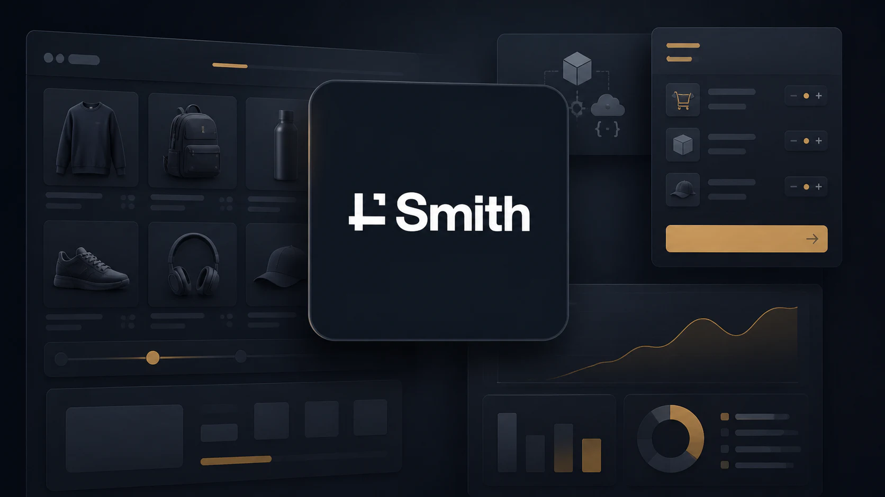

import ProjectOutcomesCard from '@/components/molecules/ProjectOutcomesCard.astro'

import ProjectPreviews from '@/components/molecules/ProjectPreviews.astro'

import ProjectComparison from '@/components/molecules/ProjectComparison.astro'

import beforeImage from './before.webp'

import afterImage from './after.webp'

## Two commerce projects at Smith

At [Smith Commerce](https://smithcommerce.com), my work as a Senior Front End Developer has spanned two client projects: **Marcone** and **F.W. Webb**. Across both, I have worked on the frontend systems that connect product discovery, purchasing, and account workflows with commerce APIs.

## Marcone: rebuilding for a headless future

My first project was the frontend rebuild of [Marcone](https://www.marcone.com/), a large commerce experience being moved away from a legacy monolith. The old storefront was slow, inaccessible, and hard to evolve. The goal was to replace it with a modern headless frontend that could move faster without waiting on backend readiness.

<ProjectOutcomesCard id="key-outcomes" projectId="smith-commerce" />

### Core challenge

This was not a greenfield marketing site. It was a storefront migration with real performance debt, accessibility issues, and delivery pressure on both the frontend and backend sides. The work only mattered if the team could improve user experience immediately while still creating space for parallel delivery and longer-term maintainability.

### What I owned

- **Front-end architecture from monorepo setup through launch,** helping shape the headless storefront foundations as the project moved into production.
- **Parallel delivery against mocked OpenAPI contracts,** so front-end and backend work could move independently without blocking each other.
- **UI systems, forms, and state patterns** using `Next.js 15`, `React 19`, `TypeScript`, `Radix UI`, `TanStack Query`, and `Zod`.
- **Developer experience improvements** through stronger linting, automation, and team standards that made delivery faster and less noisy.

### Technical highlights

- **Frontend:** `Next.js`, `React`, `TypeScript`, `Tailwind CSS`, `Radix UI`, `Lucide React`
- **State and data:** `TanStack Query`, `Zustand`, `Apollo Client`, `OpenAPI`, `React Hook Form`, `Zod`
- **Delivery and quality:** `Turborepo`, `Storybook`, `ESLint`, `Prettier`, `Husky`, `Jest`, `Playwright`, `CI/CD`

### Before and after

The difference was visible in both performance and experience:

<ProjectComparison
  id="marcone-comparison"
  label="Marcone"
  context="Storefront evolution"
  before={{
    src: beforeImage,
    alt: 'Marcone legacy storefront with its category sidebar and product catalog.',
    title: 'Legacy monolith',
    caption: 'Before — Legacy Monolith'
  }}
  after={{
    src: afterImage,
    alt: 'Marcone headless storefront with its updated navigation and account dashboard.',
    title: 'Headless storefront',
    caption: 'After — Headless Storefront'
  }}
/>

## F.W. Webb: building the purchasing experience

My second project at Smith was **F.W. Webb**, where I helped bring a new commerce experience to life. My work connected a modern storefront design with the complex purchasing needs of business customers, spanning product discovery, checkout, and account services.

<ProjectPreviews projectId="smith-commerce">

### Inside the product

</ProjectPreviews>

### The purchasing challenge

The challenge was to make a complex B2B platform feel straightforward to use. Customers needed a consistent experience from exploring the catalog to completing a purchase, while the business needed room to evolve its content, services, and workflows.

### What I contributed

- **Bringing the new storefront to life,** translating the design into responsive experiences across product discovery, purchasing, and account management.
- **Making complex commerce easier to navigate,** building customer journeys that connect a broad product catalog with the needs of business buyers.
- **Connecting design with business operations,** turning purchasing rules and account services into clear, practical interfaces.
- **Giving content teams more flexibility,** creating reusable, CMS-driven experiences that support evolving campaigns and localized content.
- **Strengthening the foundations for continued delivery,** building shared components and integration patterns that help the storefront grow consistently.

### Webb technical highlights

- **Frontend:** `Next.js`, `React`, `TypeScript`, `Tailwind CSS`, `Radix UI`
- **State, forms, and integration:** `TanStack Query`, `Zustand`, `React Hook Form`, `Zod`, `OpenAPI`
- **Content and development:** `Contentstack`, `i18next`, `Turborepo`, `Storybook`, `Vitest`

### My approach

I approached the storefront as a connected product: the design, customer journey, and underlying services all needed to work together. My focus was on carrying that consistency across the experience while giving the team reusable foundations for future work.

## Why this experience matters

These two projects broadened my commerce experience in complementary ways. Marcone centered on modernizing a storefront and improving performance and accessibility. F.W. Webb added deeper work on purchasing rules, account permissions, product discovery, and content integration. Together, they reflect the frontend work I enjoy most: making complex systems understandable for customers and maintainable for the teams building them.
