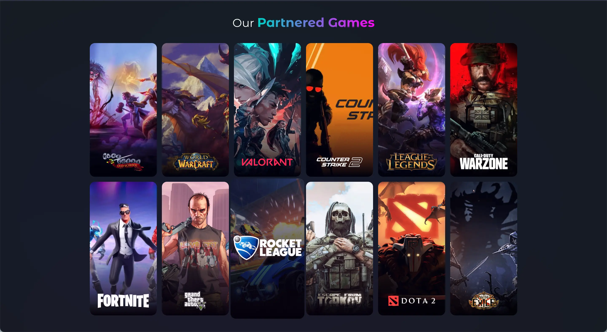

import ProjectArchitectureBrief from '@/components/molecules/ProjectArchitectureBrief.astro'
import ProjectContextLead from '@/components/molecules/ProjectContextLead.astro'
import ProjectOutcomesCard from '@/components/molecules/ProjectOutcomesCard.astro'
import ProjectPrincipleClose from '@/components/molecules/ProjectPrincipleClose.astro'
import ProjectSectionHeading from '@/components/molecules/ProjectSectionHeading.astro'

import { Image } from 'astro:assets'
import { DeviceFrame } from '@santi020k/lumen-astro'
import homeScreenshot from './home.webp'

<ProjectContextLead projectId="void" headingId="leading-innovation-in-gaming-and-esports-with-void">

## Liderar la innovación en videojuegos y esports con Void

En [Void](https://www.void.gg/), lideré el trabajo técnico de una plataforma de videojuegos y esports de rápida evolución, con necesidades de web, móvil, backend y tiempo real. El trabajo no consistía solo en hacer funcionar el producto. También se trataba de ayudar al equipo a avanzar más rápido sin que la arquitectura colapsara bajo esa velocidad.

</ProjectContextLead>

<ProjectOutcomesCard
  contextLinks={[
    { label: "Mi contribución", href: "#what-i-led" },
    { label: "Resultados en detalle", href: "#key-outcomes" },
    { label: "Aspectos técnicos", href: "#technical-highlights" }
  ]}
  headingId="outcomes"
  id="sidebar-outcomes"
  projectId="void"
>

### Resultados

</ProjectOutcomesCard>

<ProjectSectionHeading>

### Lo que lideré

</ProjectSectionHeading>

- **La dirección de arquitectura** en microservicios, microfrontends, aplicaciones móviles y funciones en tiempo real, definiendo los límites que mantuvieron coherente la plataforma mientras crecía.
- **La entrega entre disciplinas** para un equipo de más de 14 personas de ingeniería, diseño y producto que trabajaba en varias líneas simultáneamente.
- **Los sistemas de lanzamiento y los estándares de ingeniería**, incluidos CI/CD, documentación, calidad del código y las protecciones operativas que hicieron más predecible la entrega.
- **La responsabilidad sobre el rendimiento** en el comportamiento de las API, la estrategia de caché, el renderizado del frontend y las interfaces del producto en vivo basadas en `Socket.io`.

<ProjectSectionHeading>

### Resultados principales

</ProjectSectionHeading>

- **35% de mejora en el rendimiento del sistema** después de optimizar las API, la caché y los servicios en tiempo real bajo condiciones de alta concurrencia.
- **Velocidad de sprint superior al 95%**, mientras ayudaba a un equipo de 14 personas a mantener el ritmo de entrega con una hoja de ruta exigente.
- **Despliegues aproximadamente 60% más rápidos** después de mejorar CI/CD y los sistemas detrás del trabajo de lanzamiento.
- **40% menos deuda técnica**, al reforzar los estándares, los límites modulares y las expectativas de arquitectura.

<ProjectSectionHeading>

### Aspectos técnicos

</ProjectSectionHeading>

<ProjectArchitectureBrief>

  <dt>Frontend y móvil</dt>
  <dd>

`React.js`, `Next.js`, `TypeScript`, `React Native`, `Redux Toolkit`, `Mantine UI`, `CSS Modules`

  </dd>

  <dt>Plataforma y backend</dt>
  <dd>

`Node`, `Nest.js`, `Express.js`, `Socket.io`, `MongoDB`, `PostgreSQL`, `AWS`, `Docker`

  </dd>

  <dt>Calidad y experiencia de desarrollo</dt>
  <dd>

`GitHub Actions`, `Jest`, `Cypress`, `Storybook`, `Sentry`, `ESLint`, `NX`, `Developer Documentation`

  </dd>

</ProjectArchitectureBrief>

<figure>
  <DeviceFrame className="not-prose" device="laptop" screenWidth={homeScreenshot.width} screenHeight={homeScreenshot.height} scroll={false}>
    <Image src={homeScreenshot} alt="Experiencia de inicio de Void" class="m-0 block size-full rounded-none object-contain" widths={[640, 960, 1440]} sizes="(min-width: 1024px) 66vw, 100vw" />
  </DeviceFrame>
  <figcaption>La experiencia web de Void para comunidades de videojuegos y creadores.</figcaption>
</figure>

<ProjectSectionHeading>

### Impacto en el mundo real

</ProjectSectionHeading>

Void debía soportar torneos en vivo, funciones de comunidad e iteraciones rápidas del producto sin degradar el servicio. Las decisiones de arquitectura importaban porque afectaban la participación real de los usuarios, la frecuencia real de lanzamientos y la capacidad del equipo para responder rápidamente a nuevas oportunidades en la plataforma.

<ProjectSectionHeading>

### Por qué fue importante

</ProjectSectionHeading>

<ProjectPrincipleClose lead={"Void reunió mucho de lo que me importa: ritmo de producto, liderazgo de equipos, sistemas en tiempo real y una arquitectura capaz de resistir el crecimiento."}>

Es uno de los ejemplos más claros de cómo me gusta liderar: cerca del código, enfocado en los resultados y comprometido con eliminar las fricciones del equipo.

</ProjectPrincipleClose>
